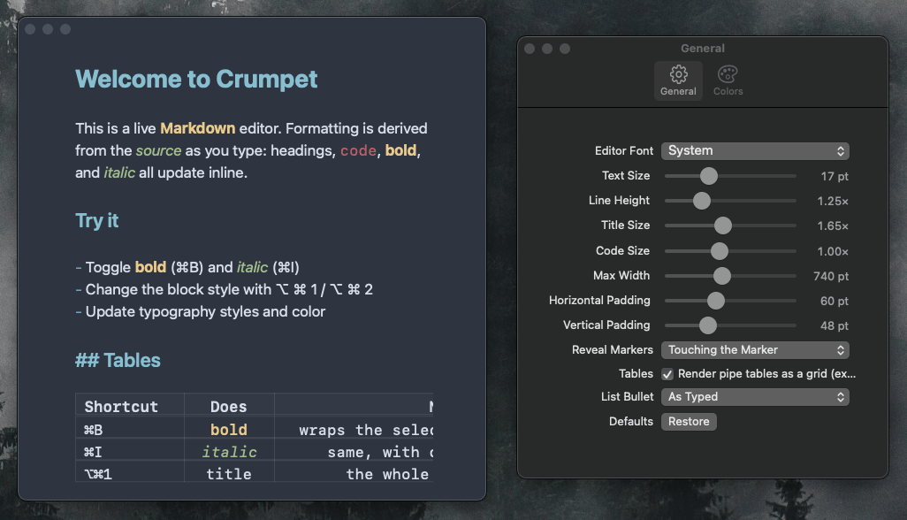

# Crumpet

<p align="center">
  
</p>

A native Markdown editor for SwiftUI on macOS and iOS, with live syntax highlighting from [tree-sitter].

- **Native text editing.** SwiftUI view, backed by `NSTextView` on macOS and `UITextView` on iOS.
- **Live highlighting.** Tree-sitter reparses incrementally as you type, so large documents stay fast.
- **Hidden markup.** The editor can hide Markdown syntax, and a hidden link shows a link icon after its text.
- **Tunable typography.** Set the typeface or register your own font, size, line height, title and code scale, column width, and padding.
- **Themeable.** Built-in preset themes from Tinted Theming, custom colors, and a light, dark, or system appearance.
- **Code block highlighting.** Fenced JSON, Bash, and TOML blocks get token colors.
- **Images.** Images alone on a line display their picture, and pasted images go to your own handler.
- **Drop-in settings panels.** Store `EditorSettings` and `EditorTheme` in `@AppStorage` and edit them with `EditorSettingsForm` and `EditorThemeForm`.
- **Smart lists.** Lists continue on Return. Tab and Shift-Tab change the indent. Backspace removes an empty marker. The bullet is customizable.
- **Typing helpers.** Typing a quote, backtick, parenthesis, or bracket over a selection wraps it, and Cmd-B and Cmd-I insert Markdown markers on iOS.
- **Find bar.** On macOS, Cmd-F opens the standard find bar with incremental search.
- **Pipe tables.** Tables render as editable tables with wrapping cells and horizontal scrolling (experimental). "Edit as Markdown" in a cell menu shows the table source until the caret leaves it, and the `.always` reveal mode shows every table as source.

## Installation

Crumpet requires macOS 15 or iOS 18 and Swift 6. Add the package to your `Package.swift`:

```swift
.package(url: "https://github.com/octavore/crumpet", from: "0.2.0")
```

Then add the `Crumpet` product to your target's dependencies.

## Quick start

```swift
import Crumpet
import SwiftUI

struct ContentView: View {
  @State private var text = "# Hello\n\nStart typing…"

  var body: some View {
    MarkdownEditor(text: $text)
      .editorFont(.serif)
      .editorFontSize(18)
      .editorLineHeight(1.4)
      .editorColorScheme(.init(heading: .blue, code: .pink, bold: .orange, italic: .teal))
  }
}
```

## Guides

### Drop-in settings panel

To let your users customize the editor without wiring each modifier by hand, persist the `EditorSettings` value and hand it to the editor. `EditorSettings` is `RawRepresentable` as JSON, so it stores directly in `@AppStorage`. Render `EditorSettingsForm` in your own `Form` to edit it.

```swift
struct EditorScreen: View {
  @AppStorage("editorSettings") private var settings = EditorSettings()
  @State private var text = ""

  var body: some View {
    MarkdownEditor(text: $text).editorSettings(settings)
  }
}

struct SettingsScreen: View {
  @AppStorage("editorSettings") private var settings = EditorSettings()
  @AppStorage("myOwnOption") private var myOwnOption = false

  var body: some View {
    Form {
      EditorSettingsForm(settings: $settings)
      // Your own rows go here.
      Toggle("My Own Option", isOn: $myOwnOption)
    }
  }
}
```

`EditorSettingsForm` renders bare rows, not a container, so it inherits the chrome of whatever `Form`, `List`, or `Section` you place it in. The example app's `SettingsView` uses it directly. Put `EditorSettingsRestoreButtons` in its own `Section` to add Restore Defaults and Undo Restore buttons.

### Live updates while updating settings

SwiftUI does not update an editor in another window while a slider drag is in progress, so on macOS the editor restyles only when the drag ends. To restyle during the drag, share one `EditorSettingsChannel` between both scenes and send each new value through it. The channel does not persist anything, so continue to store the settings in `@AppStorage`.

```swift
enum AppSettings {
  @MainActor static let editorChannel = EditorSettingsChannel()
}

// In the editor scene:
MarkdownEditor(text: $text)
  .editorSettings(settings)
  .editorSettingsChannel(AppSettings.editorChannel)

// In the settings scene:
Form { EditorSettingsForm(settings: $settings) }
  .onChange(of: settings) { _, new in AppSettings.editorChannel.send(new) }
```

### Themes and appearance

`EditorTheme` controls the editor colors, whether the built-in presets or custom `EditorCustomColors`.

`EditorAppearance` is dark mode, light mode, or the system default.

Both are `@AppStorage` types, and `EditorThemeForm` edits them with a grid of theme cards and a live preview.

```swift
struct EditorScreen: View {
  @AppStorage("editorTheme") private var theme = EditorTheme.system
  @AppStorage("editorAppearance") private var appearance = EditorAppearance.system
  @AppStorage("editorCustomColors") private var customColors = EditorCustomColors()
  @State private var text = ""

  var body: some View {
    MarkdownEditor(text: $text)
      .editorTheme(theme, customColors: customColors)
      .editorAppearance(appearance)
  }
}

struct ThemeScreen: View {
  @AppStorage("editorTheme") private var theme = EditorTheme.system
  @AppStorage("editorAppearance") private var appearance = EditorAppearance.system
  @AppStorage("editorCustomColors") private var customColors = EditorCustomColors()

  var body: some View {
    Form {
      // Omit `customColors:` to offer only the system and preset themes.
      EditorThemeForm(theme: $theme, appearance: $appearance, customColors: $customColors)
    }
  }
}
```

A preset family switches between light and dark variants based on the `EditorAppearance`. To apply a preset without the stored settings, pass a family or a light and dark pair directly:

```swift
MarkdownEditor(text: $text)
  .editorColorScheme(.solarized)
MarkdownEditor(text: $text)
  .editorColorScheme(light: EditorColorScheme(.gruvboxLight), dark: EditorColorScheme(.dracula))
```

### Code block highlighting

Fenced code blocks highlight a minimal set of languages:

| Language | Aliases                                 |
| -------- | --------------------------------------- |
| JSON     | `json`, `jsonc`, `json5`                |
| Bash     | `bash`, `sh`, `shell`, `zsh`, `console` |
| TOML     | `toml`                                  |

Blocks with no language or an unsupported one use the scheme's `code` color, as do blocks over 30,000 characters.

Syntax highlighting colors come from `EditorColorScheme.syntax`, and fall back to the `fallback` or `code` color if a scope color is not set.

```swift
let syntax = EditorColorScheme.SyntaxColors(
  keyword: .purple, string: .green, number: .orange,
  comment: .gray, function: .blue, property: .red,
  fallback: .pink)

MarkdownEditor(text: $text)
  .editorColorScheme(EditorColorScheme(code: .pink, syntax: syntax))
```

### Importing a Tinted Theming scheme

`EditorColorScheme` parses scheme files from the [Tinted Theming](https://github.com/tinted-theming/schemes) collection in the base16, base24, and tinted8 systems.

```swift
if let scheme = EditorColorScheme(tintedYAML: yaml) {
  // apply scheme
}
```

Parsing returns `nil` unless the scheme has a background, a text color, and the six accent colors below. The editor maps these base16 variables onto its colors:

| Variable | tinted8 color                | Editor color | Code block token | tinted8 `syntax:` scope |
| -------- | ---------------------------- | ------------ | ---------------- | ----------------------- |
| `base00` | `black` (`white` when light) | `background` |                  |                         |
| `base03` | `gray`                       |              | `comment`        | `comment`               |
| `base05` | `white` (`black` when light) | `text`       |                  |                         |
| `base08` | `red`                        | `listBullet` | `property`       |                         |
| `base09` | `orange`                     | `bold`       | `number`         | `constant.numeric`      |
| `base0B` | `green`                      | `code`       | `string`         | `string`                |
| `base0C` | `cyan`                       | `link`       |                  |                         |
| `base0D` | `blue`                       | `heading`    | `function`       | `entity.name.function`  |
| `base0E` | `magenta`                    | `italic`     | `keyword`        | `keyword`               |

In a tinted8 file, the palette colors fill the same variables, and a top-level `syntax:` section overrides the code block colors for the listed scopes.

`init?(tintedPalette:)` takes the same variables, but as a dictionary where keys are `base00` through `base0F`.

### Images

Image markdown (``) shows the picture when the markdown is hidden. By default, the editor loads `http`, `https`, and `file` destinations, and any other destination, including a relative path, shows as a chip. To load images from your own storage, pass `imageProvider(_:)`. It receives the destination as written and returns the image bytes. Return `nil` to show a chip.

```swift
MarkdownEditor(text: $text)
  .imageProvider { destination in
    await MyStore.imageData(for: destination)
  }
```

To handle pasted images, pass `onPasteImage(_:)` which receives a `PastedImage`. The string it returns goes into the document at the caret. If it returns `nil`, nothing happens. Without the modifier, the editor drops pasted images.

```swift
MarkdownEditor(text: $text)
  .onPasteImage { image in
    guard let name = MyStore.save(image.data, extension: image.fileExtension) else { return nil }
    return ")"
  }
```

### Custom fonts

To use a font that ships with your app, register it with Core Text, then pass its PostScript name to `editorCustomFont(_:)`. The font replaces the typeface everywhere, including code spans, code blocks, and tables. Bold and italic runs use the same font when it has no such variant. `EditorSettings` does not store the custom font, so store the name in your own setting.

```swift
CTFontManagerRegisterFontsForURL(url as CFURL, .process, nil)

MarkdownEditor(text: $text)
  .editorCustomFont("Charter-Roman")
```

### Formatting commands

To manage formatting from your own UI, hold an `EditorCommands`, attach it to the editor, and call `send(_:)`:

```swift
struct EditorScreen: View {
  @State private var text = ""
  @State private var commands = EditorCommands()

  var body: some View {
    MarkdownEditor(text: $text)
      .commands(commands)
      .toolbar {
        Button("Bold") { commands.send(.toggleBold) }
        Button("Italic") { commands.send(.toggleItalic) }
        Menu("Style") {
          ForEach(TextStyle.allCases) { style in
            Button(style.displayName) { commands.send(.setBlockStyle(style)) }
              .keyboardShortcut(style.shortcutKey, modifiers: [.command, .option])
          }
        }
      }
  }
}
```

### Document outline

`EditorCommands.outline` lists the headings of the attached editor's current text. Send `.scrollToHeading(_:)` to move the caret to one of them:

```swift
struct OutlineMenu: View {
  let commands: EditorCommands

  var body: some View {
    Menu("Outline") {
      ForEach(commands.outline) { item in
        Button(String(repeating: "  ", count: item.level - 1) + item.title) {
          commands.send(.scrollToHeading(item))
        }
      }
    }
  }
}
```

To outline text that is not in an editor, call `MarkdownOutline.items(in:)`.

## API reference

### `MarkdownEditor`

A SwiftUI `View` that edits a Markdown `String`.

```swift
init(text: Binding<String>)
```

Each modifier returns a new `MarkdownEditor`, so apply them directly to the editor, before any other SwiftUI modifier.

| Modifier                                                         | Effect                                                                                                                                                        | Default                         |
| ---------------------------------------------------------------- | ------------------------------------------------------------------------------------------------------------------------------------------------------------- | ------------------------------- |
| `.editorFont(_: EditorFont)`                                     | Typeface.                                                                                                                                                     | `.system`                       |
| `.editorCustomFont(_: String?)`                                  | Replaces the typeface, code included, with a font you registered, given by PostScript name. Falls back to `editorFont` if name is unrecognized.               | `nil`                           |
| `.editorFontSize(_: CGFloat)`                                    | Base body point size. Titles, headings, and code are relative to this.                                                                                        | `17`                            |
| `.editorTitleRatio(_: CGFloat)`                                  | Title size as a multiple of the base size. Headings stay at 22:17.                                                                                            | `28 / 17`                       |
| `.editorCodeRatio(_: CGFloat)`                                   | Inline and block code size as a multiple of the base size.                                                                                                    | `1.0`                           |
| `.editorLineHeight(_: CGFloat)`                                  | Line height as a multiple of the font's natural line height.                                                                                                  | `1.25`                          |
| `.editorMaxWidth(_: CGFloat)`                                    | Max width of the centered text column, in points.                                                                                                             | `720`                           |
| `.editorHorizontalPadding(_: CGFloat)`                           | Minimum padding on each side of the text column, in points.                                                                                                   | `16`                            |
| `.editorVerticalPadding(_: CGFloat)`                             | Padding above and below the text column, in points.                                                                                                           | `24`                            |
| `.markerRevealMode(_: MarkerRevealMode)`                         | Controls when concealed Markdown syntax is revealed.                                                                                                          | `.span`                         |
| `.experimentalTables(_: Bool)`                                   | Renders pipe tables as editable tables with wrapping cells. When off, tables stay plain text.                                                                 | `false`                         |
| `.editorColorScheme(_: EditorColorScheme)`                       | Construct colors, code block syntax colors, and the page background.                                                                                          | `.standard`                     |
| `.editorColorScheme(light:dark:)`                                | One scheme for light mode and one for dark mode. The editor switches between them with the appearance.                                                        | none                            |
| `.editorColorScheme(_: EditorColorPreset.Family)`                | The light and dark presets of a built-in family.                                                                                                              | none                            |
| `.editorTheme(_: EditorTheme, customColors: EditorCustomColors)` | Applies a theme. `customColors` supplies the colors for `.custom` and is ignored otherwise.                                                                   | `.system`                       |
| `.editorAppearance(_: EditorAppearance)`                         | Follows the system appearance or stays light or dark. Also styles the caret, selection, and scroll bars.                                                      | `.system`                       |
| `.editorTopContentInset(_: CGFloat)`                             | Starts the document below an overlaying bar of this height while still scrolling under it.                                                                    | `0`                             |
| `.onScroll(_: (CGFloat) -> Void)`                                | Called with the vertical scroll offset whenever the document scrolls. The offset is 0 at the top and ignores the top inset.                                   | none                            |
| `.onScrollVelocity(_: (CGFloat) -> Void)`                        | Called with the vertical scroll velocity in points per second when a drag ends. Positive toward the end of the document, negative toward the start. iOS only. | none                            |
| `.onPasteImage(_: (PastedImage) -> String?)`                     | Called when the user pastes an image. The returned Markdown is inserted at the caret, and `nil` pastes nothing.                                               | drops the image                 |
| `.imageProvider(_: (String) async -> Data?)`                     | Loads the picture for an image's destination. Return `nil` to show a chip.                                                                                    | loads `http(s)` and `file` URLs |
| `.commands(_: EditorCommands)`                                   | Routes formatting commands into this editor. Pass the same instance for the editor's lifetime.                                                                | none                            |
| `.editorSettings(_: EditorSettings)`                             | Applies every option in the bundle, equivalent to calling each matching modifier.                                                                             | none                            |
| `.editorSettingsChannel(_: EditorSettingsChannel)`               | Subscribes the editor to live settings updates.                                                                                                               | none                            |

The list bullet style and the list indent have no modifier of their own. Set them with `.editorSettings(_:)`.

### `EditorSettings`

A `Codable`, `Equatable`, `Sendable` struct holding every non-color option. It conforms to `RawRepresentable` with a JSON `String` raw value, so it works with `@AppStorage`. Decoding fills any missing key with its default, and invalid JSON or a key of the wrong type makes `init?(rawValue:)` return `nil`.

```swift
init(
  font: EditorFont = .system,
  fontSize: Double = 17,
  lineHeight: Double = 1.25,
  titleRatio: Double = 28.0 / 17.0,
  codeRatio: Double = 1.0,
  maxWidth: Double = 720,
  horizontalPadding: Double = 16,
  verticalPadding: Double = 24,
  markerRevealMode: MarkerRevealMode = .span,
  experimentalTables: Bool = false,
  listBullet: ListBulletStyle = .asTyped,
  listIndent: Int = 2
)
```

| Property             | Type               | Matching modifier              | Form range  |
| -------------------- | ------------------ | ------------------------------ | ----------- |
| `font`               | `EditorFont`       | `.editorFont(_:)`              |             |
| `fontSize`           | `Double`           | `.editorFontSize(_:)`          | 12 to 28    |
| `lineHeight`         | `Double`           | `.editorLineHeight(_:)`        | 1.0 to 2.0  |
| `titleRatio`         | `Double`           | `.editorTitleRatio(_:)`        | 1.0 to 2.5  |
| `codeRatio`          | `Double`           | `.editorCodeRatio(_:)`         | 0.6 to 1.6  |
| `maxWidth`           | `Double`           | `.editorMaxWidth(_:)`          | 400 to 1200 |
| `horizontalPadding`  | `Double`           | `.editorHorizontalPadding(_:)` | 0 to 160    |
| `verticalPadding`    | `Double`           | `.editorVerticalPadding(_:)`   | 0 to 160    |
| `markerRevealMode`   | `MarkerRevealMode` | `.markerRevealMode(_:)`        |             |
| `experimentalTables` | `Bool`             | `.experimentalTables(_:)`      |             |
| `listBullet`         | `ListBulletStyle`  | none                           |             |
| `listIndent`         | `Int`              | none                           | 1 to 8      |

`listIndent` is the number of spaces added to a list item's indentation when Tab is pressed. Shift-Tab removes up to that many leading spaces, or one leading tab. The form ranges limit only `EditorSettingsForm`'s controls. The editor accepts values outside them.

### `EditorSettingsForm`

A `View` of bare rows for editing an `EditorSettings`: a font picker; sliders for text size, line height, title size, code size, max width, and horizontal and vertical padding; a marker-reveal picker; a tables toggle; a list-bullet picker; and a list-indent stepper.

```swift
init(settings: Binding<EditorSettings>)
```

### `EditorSettingsRestoreButtons`

A `View` with Restore Defaults and Undo Restore buttons for an `EditorSettings`. Undo Restore puts back the settings from before the last restore, and is available only while the settings still equal the defaults. It is separate from `EditorSettingsForm` so it can sit outside the `Form`.

```swift
init(settings: Binding<EditorSettings>)
```

### `EditorSettingsChannel`

A `@MainActor` class that applies settings to every attached editor synchronously, without waiting for a SwiftUI update. Use one channel for the whole app.

| Member                             | Description                                                                             |
| ---------------------------------- | --------------------------------------------------------------------------------------- |
| `init()`                           | Creates a channel with no editors attached.                                             |
| `send(_ settings: EditorSettings)` | Restyles every attached editor before returning. Sending an unchanged value is a no-op. |

### `EditorTheme`

An enum that controls the editor's colors. It conforms to `RawRepresentable` with a `String` raw value, so it works with `@AppStorage`. The raw value is `""` for `.system`, `"custom"` for `.custom`, and the family's raw value for a preset.

| Case                                    | Colors                                                       |
| --------------------------------------- | ------------------------------------------------------------ |
| `.system`                               | `EditorColorScheme.standard`, the adaptive system colors.    |
| `.preset(EditorColorPreset.Family)`     | The family's light or dark preset, chosen by the appearance. |
| `.custom`                               | The colors of an `EditorCustomColors`.                       |

| Member                                                                                 | Description                                                                           |
| -------------------------------------------------------------------------------------- | ------------------------------------------------------------------------------------- |
| `followsAppearance`                                                                    | False only for a preset family with a single variant.                                 |
| `colorScheme(for: ColorScheme, customColors: EditorCustomColors) -> EditorColorScheme` | The scheme the theme uses in an appearance. `customColors` applies only to `.custom`. |

### `EditorCustomColors`

A struct of hex color strings, `RawRepresentable` as JSON for `@AppStorage`. A `nil` or unparseable color falls back to the construct's default.

| Member                                                                          | Description                                                                                                    |
| ------------------------------------------------------------------------------- | -------------------------------------------------------------------------------------------------------------- |
| `init()`                                                                        | Creates colors with every construct at its default.                                                            |
| `init(_: EditorColorScheme)`                                                    | Copies every color of a scheme as a `#RRGGBBAA` string.                                                        |
| `text`, `heading`, `code`, `bold`, `italic`, `link`, `listBullet`, `background` | Optional hex strings, one per construct.                                                                       |
| `syntax`                                                                        | Optional dictionary of hex strings keyed `keyword`, `string`, `number`, `comment`, `function`, and `property`. |
| `colorScheme`                                                                   | The scheme built from these colors.                                                                            |

### `EditorThemeForm`

A `View` of bare rows for choosing a theme and an appearance: a grid of theme cards next to a preview of the selected theme, and an appearance picker that is disabled for a theme with a single variant.

```swift
init(theme: Binding<EditorTheme>, appearance: Binding<EditorAppearance>)

init(
  theme: Binding<EditorTheme>, appearance: Binding<EditorAppearance>,
  customColors: Binding<EditorCustomColors>)
```

The second initializer adds a Custom theme. While Custom is selected, the form shows a Base menu that copies a preset's colors, a color picker for each construct, and a Reset button. Like `EditorSettingsForm`, it renders bare rows, so it inherits the chrome of the `Form`, `List`, or `Section` around it. On macOS, the card and preview row spans the full width in a `.formStyle(.grouped)` form.

### `EditorColorScheme`

A `Sendable`, `Equatable` struct of colors.

```swift
init(
  text: Color = .primary,
  heading: Color? = nil,
  code: Color? = nil,
  bold: Color? = nil,
  italic: Color? = nil,
  link: Color? = nil,
  listBullet: Color? = nil,
  background: Color = .editorBackground,
  syntax: SyntaxColors? = nil
)
```

| Member                                   | Description                                                                                                              |
| ---------------------------------------- | ------------------------------------------------------------------------------------------------------------------------ |
| `text`                                   | Body text, ordered list markers, and every construct without its own color.                                              |
| `heading`                                | Title and heading text. Defaults to `text`.                                                                              |
| `code`                                   | Inline code and code blocks. Defaults to `text`.                                                                         |
| `bold`                                   | Bold text. Defaults to `text`.                                                                                           |
| `italic`                                 | Italic text. Defaults to `text`.                                                                                         |
| `link`                                   | Links and images. Defaults to `text`.                                                                                    |
| `listBullet`                             | Unordered list bullet glyphs. Defaults to `text`.                                                                        |
| `background`                             | Page background. Defaults to `Color.editorBackground`.                                                                   |
| `syntax`                                 | Token colors for highlighted code blocks. Each color defaults to `code`.                                                 |
| `static standard`                        | Every construct in `.primary` on `Color.editorBackground`.                                                               |
| `init(_: EditorColorPreset)`             | Builds the scheme for a built-in preset. Falls back to `.standard` if the bundled scheme fails to parse.                 |
| `init?(tintedYAML: String)`              | Builds a scheme from a Tinted Theming file. See [Importing a Tinted Theming scheme](#importing-a-tinted-theming-scheme). |
| `init?(tintedPalette: [String: String])` | Builds a scheme from `base00` through `base0F` hex values, plus optional `syntax.` scope keys.                           |

`EditorColorScheme.SyntaxColors` holds the code block colors:

```swift
init(
  keyword: Color? = nil, string: Color? = nil, number: Color? = nil,
  comment: Color? = nil, function: Color? = nil, property: Color? = nil,
  fallback: Color = .primary
)
```

| Member     | Colors                                                    |
| ---------- | --------------------------------------------------------- |
| `keyword`  | Language keywords and literals such as `true` and `null`. |
| `string`   | String literals.                                          |
| `number`   | Numbers, dates, and command-line flags.                   |
| `comment`  | Comments.                                                 |
| `function` | Command names and function names.                         |
| `property` | Variables, object keys, and TOML keys.                    |

Each color left `nil` takes the value of `fallback`.

### `EditorColorPreset`

A `String`-backed enum of built-in schemes from [Tinted Theming](https://github.com/tinted-theming/schemes), with `CaseIterable`, `Identifiable`, and `Sendable` conformance and a `displayName`. The cases are `defaultDark`, `defaultLight`, `solarizedDark`, `solarizedLight`, `gruvboxDark`, `gruvboxLight`, `dracula`, `nord`, and `nordLight`. Build a scheme from one with `EditorColorScheme(_:)`. The scheme files are embedded in the library, so the package has no resource bundle. See [`THIRD_PARTY_LICENSES.md`](THIRD_PARTY_LICENSES.md) for their licenses.

`EditorColorPreset.Family` pairs a light and a dark preset:

| Family       | Light            | Dark            |
| ------------ | ---------------- | --------------- |
| `.classic`   | `.defaultLight`  | `.defaultDark`  |
| `.solarized` | `.solarizedLight`| `.solarizedDark`|
| `.gruvbox`   | `.gruvboxLight`  | `.gruvboxDark`  |
| `.nord`      | `.nordLight`     | `.nord`         |
| `.dracula`   | `.dracula`       | `.dracula`      |

A family has `light`, `dark`, `hasLightAndDark`, `displayName`, and `preset(for: ColorScheme)`. `hasLightAndDark` is false for `.dracula`, which has one variant.

### `EditorAppearance`

A `String`-backed enum, with `CaseIterable`, `Identifiable`, and `Sendable` conformance, that sets whether the editor follows the system appearance.

| Case      | Appearance                 |
| --------- | -------------------------- |
| `.system` | Follows the system.        |
| `.light`  | Always light.              |
| `.dark`   | Always dark.               |

`resolved(_ system: ColorScheme)` returns the appearance in effect when the system appearance is `system`. The type has a `displayName` for menus and pickers.

### `PastedImage`

A `Sendable`, `Equatable` struct passed to the `onPasteImage(_:)` closure.

| Property        | Description                                          |
| --------------- | ---------------------------------------------------- |
| `data`          | The encoded image bytes.                             |
| `mimeType`      | `image/png` or `image/jpeg`.                         |
| `fileExtension` | The extension matching `mimeType`, without the dot.  |

### `EditorCommands` and `EditorCommand`

`EditorCommands` is a `@MainActor` class that sends formatting and selection actions to the editor it is attached to, and reads its outline.

| Member                           | Description                                                                        |
| -------------------------------- | ---------------------------------------------------------------------------------- |
| `init()`                         | Creates a bridge with no editor attached.                                          |
| `send(_ command: EditorCommand)` | Applies the command to the attached editor. Does nothing if no editor is attached. |
| `outline`                        | `[OutlineItem]` for the attached editor's current text. Empty if none is attached. |

If several editors share one instance, commands go to the editor created most recently.

| `EditorCommand` case            | Effect                                                                                                                                                                                     |
| ------------------------------- | ------------------------------------------------------------------------------------------------------------------------------------------------------------------------------------------ |
| `.toggleBold`                   | With no selection, inserts `****` and places the caret in the middle. Otherwise removes `**` around the selection or adds it.                                                              |
| `.toggleItalic`                 | The same as `.toggleBold`, with `*`.                                                                                                                                                       |
| `.setBlockStyle(TextStyle)`     | Replaces the `#` or `##` prefix of the paragraph at the start of the selection with the style's prefix.                                                                                    |
| `.insertText(String)`           | Inserts the Markdown text at the caret, replacing the selection, and leaves the caret after it.                                                                                            |
| `.scrollToHeading(OutlineItem)` | Moves the caret to the start of the heading, scrolls it into view, and focuses the editor. If the text changed since the item was read, the heading with the same level and title is used. |
| `.scrollToRange(NSRange)`       | Selects the range in UTF-16 units, scrolls it into view, and focuses the editor. The range is clamped to the current text.                                                                 |

### `OutlineItem` and `MarkdownOutline`

`OutlineItem` is a heading in a document. It is `Identifiable`, `Hashable`, and `Sendable`.

| Property | Description                                                                              |
| -------- | ---------------------------------------------------------------------------------------- |
| `id`     | Position among the document's headings, in document order.                               |
| `level`  | Heading level, from 1 for `#` to 6 for `######`.                                         |
| `title`  | Heading text without the `#` prefix or closing `#` characters.                           |
| `range`  | Heading from its `#` prefix to the end of the line in UTF-16 units, excluding the break. |

`MarkdownOutline.items(in: String) -> [OutlineItem]` returns the ATX headings of a string in document order. Lines that start with `#` inside code blocks are not headings. Setext headings are not included.

### Enums

Every enum below has a `String` raw value, conforms to `CaseIterable`, `Identifiable`, and `Sendable`, and has a `displayName` for menus and pickers. All except `TextStyle` are also `Codable`.

| `EditorFont`  | Design                  |
| ------------- | ----------------------- |
| `.system`     | San Francisco (default) |
| `.serif`      | New York                |
| `.rounded`    | SF Pro Rounded          |
| `.monospaced` | SF Mono                 |

`EditorFont.previewFont` returns a 15 pt SwiftUI `Font` in the design, for previewing each option in a picker.

| `MarkerRevealMode` | Markers reveal when                                               |
| ------------------ | ----------------------------------------------------------------- |
| `.span`            | The caret touches the marked span, delimiters included (default). |
| `.line`            | The caret is anywhere on the marker's line.                       |
| `.always`          | Always. Markers are never concealed.                              |

| `ListBulletStyle` | Unordered markers render as          |
| ----------------- | ------------------------------------ |
| `.asTyped`        | The typed `-`, `*`, or `+` (default) |
| `.disc`           | •                                    |
| `.ring`           | ◦                                    |
| `.square`         | ▪                                    |
| `.dash`           | –                                    |

Bullet styles change only the drawn glyph. The Markdown source retains the typed character, and ordered markers are never replaced.

| `TextStyle` | Markdown prefix | Weight   | Size               | `shortcutKey` |
| ----------- | --------------- | -------- | ------------------ | ------------- |
| `.title`    | `#`             | Bold     | Base × title ratio | `1`           |
| `.heading`  | `##`            | Semibold | Base × 22 / 17     | `2`           |
| `.body`     | none            | Regular  | Base               | `0`           |

`shortcutKey` is a suggested `KeyEquivalent`. The editor installs no shortcuts, so pair it with your own modifiers.

### `Typography`

A namespace of defaults, form ranges, and `UserDefaults` keys. The editor reads the keys once at launch to seed its first render, and its modifiers take over once they apply.

| Option             | Default                     | Range                    | `UserDefaults` key                                         |
| ------------------ | --------------------------- | ------------------------ | ---------------------------------------------------------- |
| Font               | `EditorFont.system`         |                          | `EditorFont.defaultsKey` (`editorFont`)                    |
| Base size          | `defaultBaseSize`           | `sizeRange`              | `sizeDefaultsKey` (`editorFontSize`)                       |
| Line height        | `defaultLineHeightMultiple` | `lineHeightRange`        | `lineHeightDefaultsKey` (`editorLineHeightMultiple`)       |
| Title ratio        | `defaultTitleRatio`         | `titleRatioRange`        | `titleRatioDefaultsKey` (`editorTitleRatio`)               |
| Code ratio         | `defaultCodeRatio`          | `codeRatioRange`         | `codeRatioDefaultsKey` (`editorCodeRatio`)                 |
| Max width          | `defaultMaxTextWidth`       | `maxTextWidthRange`      | `maxTextWidthDefaultsKey` (`editorMaxTextWidth`)           |
| Horizontal padding | `defaultHorizontalPadding`  | `horizontalPaddingRange` | `horizontalPaddingDefaultsKey` (`editorHorizontalPadding`) |
| Vertical padding   | `defaultVerticalPadding`    | `verticalPaddingRange`   | `verticalPaddingDefaultsKey` (`editorVerticalPadding`)     |
| Reveal mode        | `MarkerRevealMode.span`     |                          | `MarkerRevealMode.defaultsKey` (`markerRevealMode`)        |
| Tables             | `defaultTablesEnabled`      |                          | `tablesDefaultsKey` (`editorTablesEnabled`)                |
| List bullet        | `defaultListBulletStyle`    |                          | `ListBulletStyle.defaultsKey` (`editorListBulletStyle`)    |
| List indent        | `defaultListIndent`         | `listIndentRange`        |                                                            |

### `Color` extensions

| Member                    | Description                                                                                                                                                             |
| ------------------------- | ----------------------------------------------------------------------------------------------------------------------------------------------------------------------- |
| `static editorBackground` | The editor's adaptive page background (`textBackgroundColor` on macOS, `systemBackground` on iOS). Match surrounding chrome to it.                                      |
| `init?(hex: String)`      | Parses `#RGB`, `#RRGGBB`, or `#RRGGBBAA`, with or without `#`. In-between lengths use the leading 8, 6, or 3 digits. Nil for non-hex characters or fewer than 3 digits. |

## Example app

The [`Example/`](Example) directory is a standalone Swift package that imports `Crumpet` as a dependency, the same way a real app would (see [`Example/Package.swift`](Example/Package.swift)). It contains an editor and a settings screen with a General tab (`EditorSettingsForm`) and a Theme tab (`EditorThemeForm`: theme cards, a preview, and custom color pickers). It stores settings in `@AppStorage`, holds the document in memory only, and does not make network requests.

Build and run it from the `Example/` directory:

```sh
cd Example
swift build              # compile the app against the library
strudel build            # macOS app bundle
strudel run              # run macOS app bundle
strudel run --sim        # iOS Simulator
strudel run --device     # connected device
```

## Development

The library and example are separate packages. From the repo root:

```sh
swift build                        # build the library
swift test --skip PerformanceTests # run the library tests
swift build --package-path Example # build the standalone example
```

The same tasks are available through `axo`:

```sh
axo build            # swift build
axo test             # swift test --skip PerformanceTests
axo fmt              # swift format the whole repo
axo readme:lint      # lint README.md with rumdl
axo readme:fmt       # format README.md with rumdl
axo presets:update   # download the Tinted Theming schemes and regenerate BundledSchemes.swift
axo release 0.2.0    # tag the current commit and push it to trigger a release
```

`axo release` requires a clean working tree.

## Dependencies

Crumpet uses [swift-tree-sitter](https://github.com/tree-sitter/swift-tree-sitter) with the following grammars:

- [Markdown](https://github.com/tree-sitter-grammars/tree-sitter-markdown)
- [JSON](https://github.com/tree-sitter/tree-sitter-json)
- [Bash](https://github.com/tree-sitter/tree-sitter-bash)
- [TOML](https://github.com/tree-sitter-grammars/tree-sitter-toml)

[tree-sitter]: https://tree-sitter.github.io/tree-sitter/
